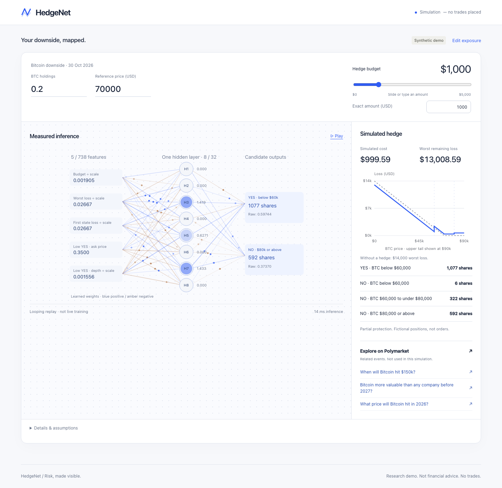

# HedgeNet

Turn a description of financial risk into a neural hedge simulation—and look inside the network that sizes it.

## How It Works

Say you hold Bitcoin and want to soften a price drop:

> I hold 0.2 BTC. I want protection if Bitcoin falls below $70,000 on October 30, 2026. My hedge budget is $1,000.

[Jev](https://typesafe.ai/) interprets the exposure in your words. A small trained
neural network takes the structured inputs and synthetic market data, then
proposes how many YES/NO shares to hold. Deterministic financial code checks the
budget, available depth, and payouts across the modeled scenarios:

```text
Net loss = original loss + purchase cost including fees − payout
```

You see the positions, what they cost, and the downside that remains. Move the
budget slider and run the same model with a different constraint. If the basket
doesn't improve worst-case loss, HedgeNet doesn't recommend it.

The interesting part is that you can look inside:

- **738 encoded features, 32 hidden units.** The visualization shows a slice of
  the actual inputs, learned weights, and activations.
- **Measured inference, replayed.** The flowing connections replay a completed
  forward pass. Pause the animation to inspect the numbers.
- **Separate building and checking.** Codex authored and ran training code in a
  [CreateOS sandbox](https://createos.sh/products/sandbox); host-side financial
  code evaluated its outputs independently. Training happens offline, not every
  time someone asks for a hedge.

The frontend, backend, and numerical model now run together in CreateOS.
[Stripe Projects](https://projects.dev/s#v1:createos~project) provisioned the
CreateOS project and Free plan; Jev and Codex were integrated separately.

## Play With It

**[Try HedgeNet live →](https://01m55gps20t94024xvf546rg91-3000.app.sb.createos.sh)**

Choose **A drop in Bitcoin**, click **Build my demo hedge**, then move the budget
slider. Or write your own BTC exposure for Jev to interpret. The preset bypasses
Jev, so you can jump straight into the neural simulation. If the sandbox is
waking up, give it a moment and refresh.

This is an experimental **synthetic BTC demo**, not live-market hedging or
financial advice. The Polymarket links are for discovery, not the simulated
positions. Weather is illustrative. No trades are placed.

To explore locally with Node 24 and pnpm 12.4.2:

```sh
git clone https://github.com/CaptainLEVI-XXX/hedgenet.git
cd hedgenet
pnpm install --frozen-lockfile
pnpm dev
```

Open http://127.0.0.1:3000. The hosted demo includes the trained model; a clone
doesn't include private weights or credentials. See [the engineering reference](ENGINEERING.md)
for model setup, Jev configuration, tests, and deployment, or [CONTRIBUTING.md](CONTRIBUTING.md)
to work on the code.



Built for the **CreateOS × Stripe Projects hackathon**. The experimental numerical
runtime uses [Handwired](https://github.com/chenglou/handwired); its MIT notice is
included with the deployed runtime.
